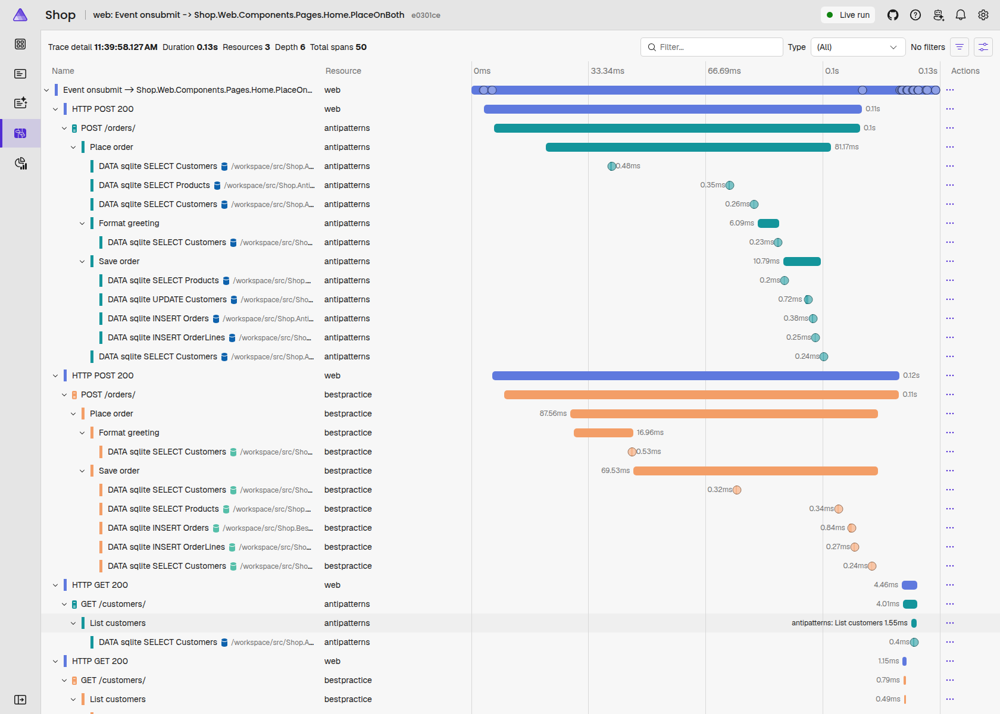
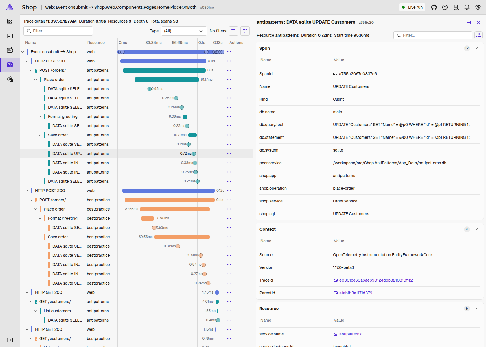
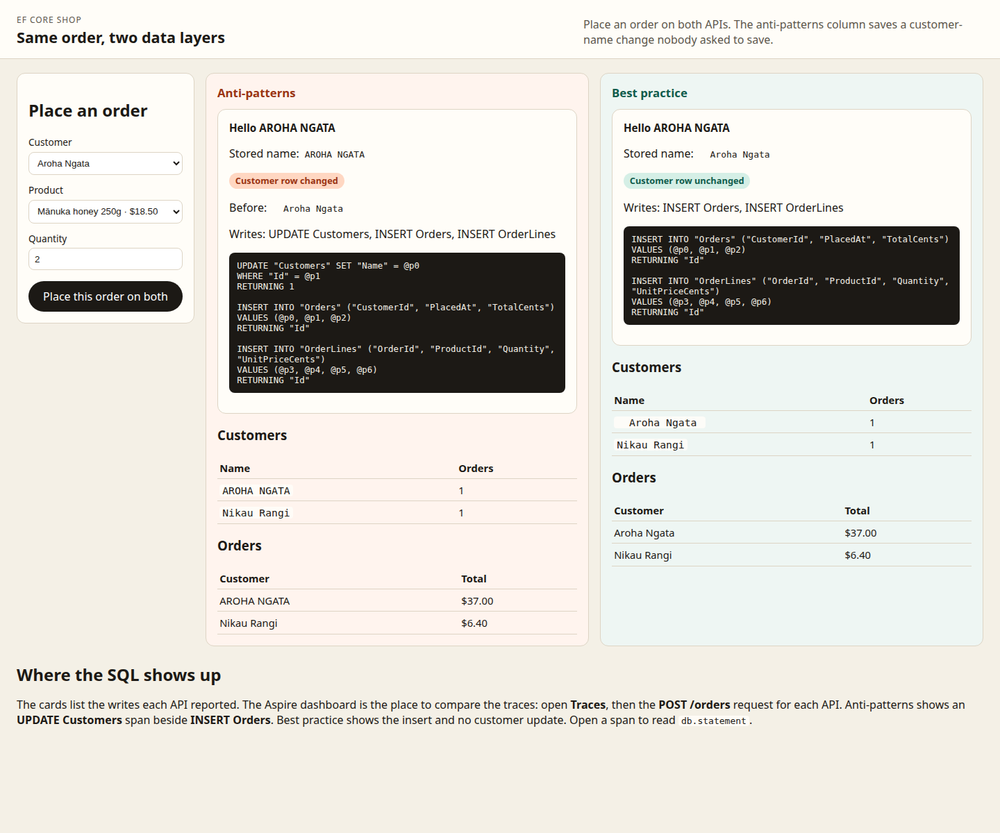

# EF Core anti-patterns

Companion code for Darrel Schreyer's LinkedIn article, *Your DbContext Is Already the Repository: Three EF Core Anti-Patterns Worth Unlearning* ([article link]).

Two ASP.NET Core apps share one small shop: customers, products, and orders. They expose the same endpoints. `Shop.AntiPatterns` keeps an inherited generic repository, unit of work, and a single scoped `DbContext`. `Shop.BestPractice` uses the context directly. A Blazor desk places the same order on both. The .NET Aspire AppHost is the startup project, so the dashboard traces show the SQL each app actually sends.

## The three anti-patterns

These are patterns teams commonly inherit: joining an existing codebase, picking up a contract, or modernising a .NET stack. Each one made sense to someone at the time.

### 1. A generic repository over EF Core

`DbSet<T>` is already the repository, and `DbContext` is already the Unit of Work. A generic `IRepository<T>` (`GetById`, `GetAll`, `Add`, `Update`, `Remove`) rarely adds a capability. It hides the ones you already have: `Include`, projections, `AsNoTracking`, `AsSplitQuery`, `ExecuteUpdate` / `ExecuteDelete`, compiled queries, and composing an `IQueryable` before it hits the database.

The anti-patterns list endpoints call `GetAllAsync`. That method has nowhere to put a projection, so it loads every customer with orders, lines, and products, then filters in memory. The best-practice list endpoints project with `AsNoTracking` and let the database do the search.

### 2. Unit of Work as an implementation detail

The unit of work is not a type you inject. It is the lifetime of a `DbContext` instance plus the call to `SaveChanges`. Everything that context tracks between creation and save is the unit. An `IUnitOfWork` whose `SaveChangesAsync` forwards to the context hides which context you have, how long it has been alive, and what else it is tracking.

### 3. One scoped `DbContext` shared across a request

`AddDbContext` registers the context as scoped, so every service in a request receives the same instance. One handler and one `SaveChanges` is a reasonable shape. Several services writing into the same change tracker is not: any save flushes every pending change, including mutations nobody meant to persist.

## What the two apps show

`GreetingService` in the anti-patterns app loads a customer and formats the name on the tracked entity (trim, then upper case) so a confirmation can greet them. `OrderService` adds an order and calls `SaveChanges`. It never mentions `Customer`. The shared tracker still writes the name change.

The best-practice handler reads the name with a no-tracking projection inside a short-lived context and throws that context away. A second context inserts the order. `SaveChanges` there has nothing else to flush.

The seeded customer used for the surprise is Aroha Ngata, stored with two leading spaces and one trailing space. After a place-order, the anti-patterns database holds `AROHA NGATA`. The best-practice database still holds the padded name. If that row has already been upper-cased, EF Core skips the update, because the tracked value did not change. Delete the app's `App_Data` folder to reseed.

| | Anti-patterns | Best practice |
| --- | --- | --- |
| Place order | `UPDATE Customers`, `INSERT Orders`, `INSERT OrderLines` | `INSERT Orders`, `INSERT OrderLines` |
| List customers | Load the full graph, then filter in memory | `AsNoTracking` projection; the search is in the SQL |
| Rename | Load the entity, mutate it, `SaveChanges` | `ExecuteUpdate` sends one `UPDATE` and does not load the entity |
| Context lifetime | One scoped `DbContext` shared by the greeting service, the order service, and the endpoints | `AddPooledDbContextFactory` for the order. A scoped context for a simple read. |
| Repository | Generic `IRepository<T>` plus `IUnitOfWork` | One `ICustomerRepository` with `FindForCheckoutAsync`. It does not call `SaveChanges`. The handler owns the unit of work. |

## Where to look in the Aspire dashboard

The traces are the comparison. The shop desk also prints the SQL on the card; that is a convenience.

1. Start the AppHost (see [How to run](#how-to-run)). The console prints the dashboard URL. It includes a login token.
2. Open **Traces**.
3. Open the place-order trace.
   - From the shop desk, that trace is named **Event onsubmit → Shop.Web.Components.Pages.Home.PlaceOnBoth**. It contains the `web`, `antipatterns`, and `bestpractice` resources.
   - From Scalar, an `.http` file, or `curl`, each API has its own trace named **POST /orders**.

Inside the anti-patterns `POST /orders` span, under **Save order**, the waterfall shows **UPDATE Customers** beside **INSERT Orders** and **INSERT OrderLines**. The best-practice **Save order** span shows the two inserts and no customer update. Aspire labels each database span `DATA sqlite`, then that name, then the database file.

Open the **UPDATE Customers** span. The details include:

- `db.statement` and `db.query.text`, the SQL text
- `shop.sql`, the short name (`UPDATE Customers`)
- `shop.app` (`antipatterns` or `bestpractice`)
- `shop.operation` (`place-order`)
- `shop.service` (the service that owned the context: `OrderService` or `CustomerRepository`)

The parent spans are named for the step: **Place order**, **Format greeting**, **Save order**.





SQL text is captured with `OpenTelemetry.Instrumentation.EntityFrameworkCore` 1.17.0-beta.1. `SetDbStatementForText` was removed in 1.13: the instrumentation always records the command. The service defaults then set the span name and copy the shop tags onto that span, and write the command text onto `db.statement` and `db.query.text` so the statement stays readable in the dashboard.

## The shop desk

The `web` resource is a Blazor Server page. Choose a customer, a product, and a quantity, then place the order on both APIs. Each column shows whether the stored customer name changed, the write list, and the SQL. Customer names are shown in a monospace box so the seeded padding stays visible.



## How to run

You need a .NET 10 SDK. `global.json` sets the minimum to 10.0.100 and `rollForward` to `latestFeature`, so any installed .NET 10 SDK is accepted, including a later feature band such as 10.0.4xx. The highest installed 10.0 SDK is the one that runs. The file does not roll forward to .NET 11, and a .NET 8 or 9 SDK is not enough.

The AppHost uses the Aspire 13.6.2 SDK (`Aspire.AppHost.Sdk` 13.6.2). `dotnet run` on that project is handed to the Aspire CLI. Install it once if `aspire` is not on your path:

```bash
dotnet tool install -g Aspire.Cli --version 13.6.2
```

```bash
git clone https://github.com/nabs-darrel-schreyer/efcore-anti-patterns.git
cd efcore-anti-patterns
```

**Visual Studio or Rider.** Open [`efcore-anti-patterns.slnx`](efcore-anti-patterns.slnx) and press F5. The AppHost is marked `DefaultStartup`, so it starts both APIs, the shop desk, and the dashboard. An `.slnx` file has one startup project, so the solution does not list the three apps as multiple startup projects. You do not start them yourself.

**Visual Studio Code.** Open the folder and press F5. [`.vscode/launch.json`](.vscode/launch.json) builds the solution and starts the AppHost.

**CLI, from the repo root.**

```bash
dotnet run --project src/Shop.AppHost
```

Use the `https` launch profile (it is the default). The `http` profile is rejected by Aspire unless unsecured transport is explicitly allowed. The console prints the dashboard URL. The desk is the `web` resource. Proxies keep the launch-settings ports: the desk on `http://localhost:5180` and `https://localhost:7180`, anti-patterns on 5181/7181, best practice on 5182/7182.

`dotnet build` at the repo root builds the solution. A plain `dotnet run` there does not start the demo. `dotnet run` looks for a project in the current directory, the root has a solution file rather than a project, and the CLI does not launch the solution's startup project.

SQLite files are created under each API's `App_Data` directory and are gitignored. Delete those folders to reseed.

**APIs without the dashboard.** Useful when you only want Scalar or the `.http` files. The desk can still call them: its `appsettings.json` points at these ports.

```bash
dotnet run --project src/Shop.AntiPatterns
dotnet run --project src/Shop.BestPractice
dotnet run --project src/Shop.Web
```

Scalar is at `/scalar` on each API. [`src/Shop.AntiPatterns/Shop.AntiPatterns.http`](src/Shop.AntiPatterns/Shop.AntiPatterns.http) and [`src/Shop.BestPractice/Shop.BestPractice.http`](src/Shop.BestPractice/Shop.BestPractice.http) repeat the requests. EF Core command logging is on, so the extra `UPDATE` is also printed in the API console.

**Tests.**

```bash
dotnet test tests/Shop.Tests
```

The tests place an order through each API. They check the stored name and the write list, and they check the EF Core spans: the anti-patterns span list contains `UPDATE Customers` and `INSERT Orders` with `db.statement` set, and the best-practice span list contains the insert and no customer update. Tags `shop.app`, `shop.operation`, and `shop.service` are asserted on those spans.

## Endpoints

Both APIs expose the same routes.

| Method | Path | Purpose |
| --- | --- | --- |
| GET | `/customers?search=` | List customers. Optional case-insensitive name search. |
| GET | `/customers/{id}` | One customer. |
| PATCH | `/customers/{id}` | Rename. Body `{ "name": "..." }`. |
| GET | `/products` | Catalogue. |
| GET | `/orders` | Orders, newest first. |
| GET | `/orders/{id}` | One order. |
| POST | `/orders` | Place an order. Body `{ "customerId": 1, "lines": [ { "productId": 1, "quantity": 2 } ] }`. |
| GET | `/health`, `/alive` | Health checks, Development only. |
| GET | `/scalar` | API reference. |

`POST /orders` returns the greeting, the customer name before and after, whether it changed, and the write summaries plus the SQL text.

## Project layout

```
efcore-anti-patterns.slnx          AppHost is the startup project
global.json                        any .NET 10 SDK (10.0.100 or later)
Directory.Build.props              nullable and warnings as errors
docs/                              dashboard and desk screenshots
.vscode/                           Visual Studio Code launch and build tasks
src/Shop.AppHost/                  Aspire 13.6.2 orchestrator
src/Shop.ServiceDefaults/          OpenTelemetry, health checks, service discovery
src/Shop.Shared/                   entities, SQLite, seed, SQL span names, write log
src/Shop.AntiPatterns/             inherited repository, unit of work, shared context
src/Shop.BestPractice/             context, factory, projection, ExecuteUpdate
src/Shop.Web/                      Blazor desk, side by side
tests/Shop.Tests/                  WebApplicationFactory checks, including span names
```

## When a repository still makes sense

Skip the generic repository by default. A repository earns its place when:

- It is an aggregate-root repository, with specific, intent-revealing methods rather than generic CRUD.
- It encapsulates a complex or reused query, so the shape lives in one place.
- You genuinely need to swap persistence, rather than "we might move off SQL Server one day".
- It is an anti-corruption boundary around a legacy schema or another team's database.

Leave `SaveChanges` with the caller. The caller owns the context lifetime, so the caller owns the unit of work. `ICustomerRepository.FindForCheckoutAsync` in the best-practice app is that shape.

## When to prefer `IDbContextFactory<T>`

Register `AddDbContextFactory`, or `AddPooledDbContextFactory` when you want pooling. Create a context with `await using` for each unit of work. Prefer a factory when:

- **Blazor Server.** A `DbContext` is not thread-safe, and a circuit can live far longer than a request. The desk in this repo never holds a context: it calls the APIs.
- **Background services and hosted workers.** There is no request scope, and a context that lives as long as the worker grows without limit.
- **Parallel work.** One context per concurrent operation.
- **Desktop apps (WPF / MAUI).** Windows and view models live a long time; units of work should not.
- **Independent transactions.** An audit write or outbox entry that must commit, or fail, on its own.

A scoped context is a good fit when the request is simple: one handler, one context, one read or one `SaveChanges`. The best-practice customer list is that shape. There is no need to refactor it for its own sake.

This repository does not include a licence file.
